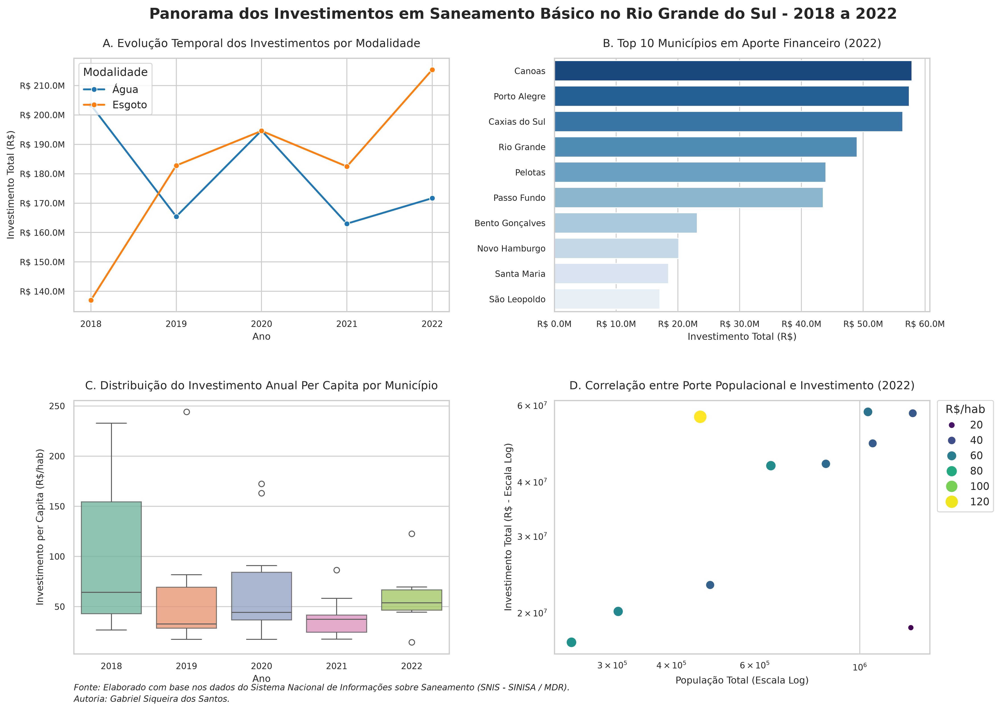

# Panorama dos Investimentos em Saneamento Básico no Rio Grande do Sul (2018–2022)

Este repositório contém uma análise descritiva e exploratória dos investimentos em infraestrutura de saneamento básico (abastecimento de água potável e esgotamento sanitário) nos municípios do Estado do Rio Grande do Sul, abrangendo a janela temporal de **2018 a 2022**.

O projeto utiliza a linguagem **Python** e as bibliotecas **Seaborn**, **Matplotlib** e **Pandas** para consolidar indicadores financeiros e operacionais em um painel analítico integrado, formatado sob padrões científicos e visuais rigorosos.

# Contexto e Recorte Metodológico

A escolha do quinquênio **2018–2022** foi definida propositalmente para analisar a transição regulatória do setor de saneamento no Brasil:

1. **Biênio Pré-Marco (2018–2019):** Diagnóstico da alocação de recursos sob o regime regulatório anterior, marcado por contratos de programa estaduais e baixo ritmo de expansão em esgotamento.
2. **Ano de Transição (2020):** Promulgação da **Lei Federal nº 14.026/2020** (Novo Marco Legal do Saneamento Básico), que instituiu a meta compulsória de 99% de atendimento em água e 90% em coleta e tratamento de esgoto até 31 de dezembro de 2033.
3. **Biênio Pós-Marco (2021–2022):** Primeira fase de adaptação dos municípios e concessionárias (revisão de capacidade econômico-financeira, regionalização em blocos e preparação para privatizações/concessões, como no caso da Corsan).
4. **Valores financeiros deflacionados pelo IPCA/IBGE (base: dezembro/2022) para assegurar comparabilidade intertemporal do esforço real de capital.

# Visualizações e Resultados

Abaixo está o painel integrado gerado a partir do processamento dos microdados:

# Estrutura do Painel Gráfico

O script gera uma figura multipainel (`2x2`) em alta resolução (300 DPI) composta por quatro visualizações complementares:

* **Gráfico A — Evolução Temporal dos Investimentos por Modalidade:** Linhas temporais contrastando os montantes acumulados investidos em água versus esgoto no Estado, evidenciando o descasamento histórico de prioridades.
* **Gráfico B — Top 10 Municípios em Aporte Financeiro (Ano Mais Recente):** Gráfico de barras horizontais indicando a concentração dos maiores volumes absolutos de investimento nos polos demográficos e industriais do RS.
* **Gráfico C — Distribuição do Investimento Anual Per Capita por Município:** Boxplot mostrando o valor mediano por habitante ($R\$/\text{hab}$) e a dispersão dos municípios, revelando obras estruturantes locais (*outliers*) em contraste com a mediana estadual.
* **Gráfico D — Correlação entre Porte Populacional e Investimento:** Gráfico de dispersão em escala bi-logarítmica relacionando população e volume de capital, mapeando a intensidade de investimento per capita pelo diâmetro e gradiente de cor dos pontos.

---

# Dados e Atribuição

* **Fonte Primária:** Sistema Nacional de Informações sobre Saneamento (**SNIS**), sob a custódia original do Ministério do Desenvolvimento Regional (**MDR**) e Ministério das Cidades (**MCID**), via projeto *Base dos Dados* (`br_mdr_snis`).
* **Nota de Rodapé Científica:**
  > *Fonte: Elaborado com base nos dados do Sistema Nacional de Informações sobre Saneamento (SNIS / MDR).*  
  > *Autoria: Gabriel Siqueira dos Santos.*

## Tecnologias Utilizadas

* **Python 3.10+**
* **Pandas** (Tratamento tabular, cálculo de variáveis *per capita* e formato *long/melted*)
* **Seaborn** (Visualizações estatísticas e paletas temáticas)
* **Matplotlib** (Controle fino de subplots, ajustes de padding, escalonamento logarítmico e formatação de eixos monetários)
